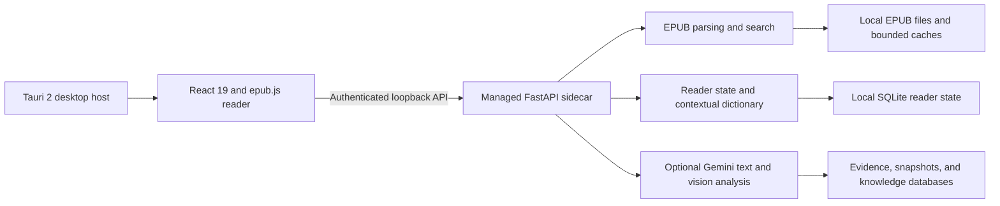

<div align="center">
  

# BookBuddy

### A private, local-first EPUB reader with spoiler-aware, optional AI assistance.

[](https://github.com/youraverageguy-123/BookBuddy/releases)
[](https://github.com/youraverageguy-123/BookBuddy/releases)
[](#current-status)
[](https://tauri.app/)
[](https://react.dev/)
[](https://www.python.org/)
[](LICENSE)

[Download](https://github.com/youraverageguy-123/BookBuddy/releases/latest)
·
[Documentation](docs/desktop_reader.md)
·
[Roadmap](#roadmap)
·
[Report an issue](https://github.com/youraverageguy-123/BookBuddy/issues)

</div>

> [!IMPORTANT]
> BookBuddy is pre-release software. Its current Windows installer and portable bundle are unsigned, so Windows may display a security warning. Download builds only from this repository's Releases page.

## About BookBuddy

BookBuddy is a reading-first desktop application for people who want a capable EPUB library without giving up the book's original presentation. It preserves publisher typography, headings, drop caps, images, indents, and structural layout while adding search, notes, bookmarks, collections, reading statistics, and configurable reading modes.

Your books and reading state remain on your device. Core reading does not require an AI account or API key. If you configure Gemini, BookBuddy can optionally explain or translate selected text and build chapter-bounded story knowledge intended to reduce exposure to information beyond your current reading progress.

## Current features

### Publisher-faithful EPUB reading

- Import EPUB files through drag-and-drop, `Ctrl+O`, or the Library command.
- Display covers, publisher styling, embedded fonts, headings, drop caps, images, indents, and structural layouts.
- Navigate hierarchical tables of contents, including grouped omnibus structures.
- Resume from the last saved location with chapter and book progress tracking.
- Search the current chapter, previously reached text, or—after confirmation—the whole book.
- Choose between paged and continuous-scrolling layouts.
- Enter distraction-free fullscreen mode and navigate with the keyboard.
- Open embedded illustrations in a zoomable and pannable image viewer.
- Use paper, night, sepia, OLED, or forest reader themes.
- Adjust fonts, type size, line height, paragraph spacing, column width, margins, alignment, hyphenation, and image scale.
- Override appearance for one book without changing global reader defaults.

### Library and reading state

- Home, Library, and Collections views.
- Continue-reading, recent, favorite, pinned, want-to-read, and finished states.
- Custom collections and automatic shelves based on reading state.
- Library search, filtering, sorting, and compact or comfortable layouts.
- Bookmarks tied to precise EPUB locations.
- Highlights, underlines, colored notes, and searchable annotations.
- Local reading-time statistics and personalized remaining-time estimates.
- Exportable notes and reading statistics.
- Local progress and settings migration across supported BookBuddy upgrades.

### Contextual reading tools

- Context-sensitive lookup for selected words and passages.
- Local dictionary definitions when optional WordNet data is installed.
- Local pronunciation when the optional pronunciation corpus is available.
- Grammar-oriented explanations for function words.
- Story-aware lookup constrained by the reader's completed knowledge boundary.
- Optional AI explanations and translations for selected text.

### Optional chapter and image analysis

When Gemini credentials are configured, BookBuddy can:

- Analyze completed chapter content in the background.
- Build evidence-backed story knowledge for contextual lookups.
- Track entities, events, relationships, terminology, and changes over time in its local data pipeline.
- Use separate optional Vision credentials for low-confidence image-analysis cases.

These backend capabilities support the reader and contextual dictionary. BookBuddy does not yet include public relationship, character, or timeline exploration pages.

### Desktop operation

- Tauri-managed local FastAPI backend.
- Authenticated random-port loopback communication in packaged builds.
- Native startup splash with managed backend readiness checks.
- Background-task status and recovery controls.
- Local database integrity, backup, and optimization tools.
- Bounded cache inspection and cleanup.
- API keys protected for the current Windows account.
- Local reading-data export and reset controls.

## Privacy and Gemini

BookBuddy is designed as a local-first application.

| Capability | API key required? | Behavior |
|---|---:|---|
| EPUB import and reading | No | EPUB content and reader state remain in BookBuddy's local data folders. |
| Progress, collections, notes, and bookmarks | No | Stored locally in reader-state storage. |
| EPUB search | No | Uses a local search index. |
| Dictionary and pronunciation | No | Available locally when their optional datasets are installed. |
| AI explanation and translation | Yes | The selected text and relevant bounded context may be sent to Gemini. |
| Chapter analysis | Yes | Current-chapter analysis inputs may be sent to Gemini when analysis is enabled and credentials are configured. |
| AI image fallback | Yes | Uses separately configured Vision credentials only for eligible low-confidence cases. |

BookBuddy limits story-aware results to the latest completed chapter knowledge available to the reader. This is a spoiler-reduction boundary, not a guarantee that generated text can never contain an unwanted inference.

Saved credentials are protected for the current Windows account. Their values are not returned by the settings API and are excluded from normal logs and data exports.

The image pipeline is local-first. Local metadata, hashing, preprocessing, and OCR are preferred; Gemini Vision is optional and isolated from the text-AI key pool.

## Installation

### Windows installer

1. Open [GitHub Releases](https://github.com/youraverageguy-123/BookBuddy/releases/latest).
2. Download `BookBuddy_<version>_x64-setup.exe`.
3. Run the installer.
4. Launch BookBuddy from the installed application.

The installer is currently unsigned. Confirm that the file came from this repository before continuing through any Windows warning.

### Portable edition

1. Download `BookBuddy_<version>_portable.zip` from the same release.
2. Extract the complete `BookBuddy` folder.
3. Launch `BookBuddy.exe` from inside that folder.
4. Keep the application and its generated data folders together when moving the portable installation.

Do not run the executable directly from inside the ZIP archive.

## First use

1. Open the Library and import an EPUB with the import button, drag-and-drop, or `Ctrl+O`.
2. Select the book to start reading.
3. Open the typography controls to choose a layout, theme, font, and spacing.
4. Select text to use the dictionary, create a highlight or note, search, or copy it.
5. Optionally open **Settings → AI** to save one or more Gemini API keys.
6. Leave the AI fields empty if you want to use BookBuddy as an offline reader.

## Architecture



The packaged application owns its backend process and communicates over a random loopback port using a one-time bearer token. Source-development runs may use the fixed local development URL instead.

BookBuddy keeps operational reader state separate from per-book evidence databases. Notes, bookmarks, and settings do not become story facts.

## Technology

| Area | Technology |
|---|---|
| Desktop shell | Tauri 2, Rust |
| User interface | React 19, TypeScript, Vite |
| EPUB rendering | epub.js |
| Backend API | Python, FastAPI, Uvicorn |
| EPUB parsing | EbookLib, Beautiful Soup |
| Validation | Pydantic |
| Storage | SQLite and local files |
| Optional AI | Google GenAI / Gemini (Recommended) | Custom Models based on API providers |
| Testing | Python `unittest`, Vitest, Testing Library |

## Project structure

```text
backend/       FastAPI application, EPUB processing, reader services, and analysis
frontend/      React reader and Tauri desktop host
config/        Canonical version and runtime configuration
docs/          Architecture, subsystem, and acceptance documentation
packaging/     Frozen-backend packaging specification
requirements/  Core and optional Python dependency sets
scripts/       Version checks and Windows desktop packaging
tests/         Backend, integration, regression, and acceptance tests
```

Generated libraries, caches, logs, databases, build output, and release artifacts are intentionally excluded from source control.

## Development setup

The documented development environment is Windows PowerShell. Python 3.13 is the currently verified interpreter, not a declared minimum version.

### Prerequisites

- Git
- Python 3.13
- Node.js and pnpm
- Rust with the MSVC toolchain for native desktop builds
- Visual Studio Build Tools with the Windows SDK for packaging

### Install the source dependencies

```powershell
git clone https://github.com/youraverageguy-123/BookBuddy.git
cd BookBuddy

py -3.13 -m venv venv
.\venv\Scripts\python.exe -m pip install --upgrade pip
.\venv\Scripts\python.exe -m pip install -r requirements\requirements.txt

cd frontend
pnpm install --frozen-lockfile
cd ..
```

### Optional Python capabilities

Install only the integrations you intend to use:

```powershell
# Gemini provider
.\venv\Scripts\python.exe backend\dependency_manager.py --ai-gemini --install

# Contextual dictionary and pronunciation packages
.\venv\Scripts\python.exe backend\dependency_manager.py --dictionary --install

# Local image-analysis pipeline
.\venv\Scripts\python.exe backend\dependency_manager.py --image --install
```

The dictionary subsystem also requires configured Open English WordNet data and an English spaCy pipeline for its complete local capability set. Missing optional resources degrade the affected section without preventing core reader startup.

### Run in browser-development mode

Start the backend:

```powershell
.\venv\Scripts\python.exe -m uvicorn --app-dir backend app:app --host 127.0.0.1 --port 8000
```

In a second PowerShell window, start Vite:

```powershell
cd frontend
pnpm dev
```

The browser build uses `http://127.0.0.1:8000` unless `VITE_BACKEND_URL` overrides it.

### Run checks

```powershell
# Backend and integration tests
.\venv\Scripts\python.exe -m unittest discover -s tests -t . -v

# Frontend checks
cd frontend
pnpm build
pnpm lint
pnpm test
```

### Build the Windows application

Install the Rust MSVC toolchain and Visual Studio Build Tools before packaging:

```powershell
winget install Rustlang.Rustup

winget install Microsoft.VisualStudio.2022.BuildTools `
  --override "--wait --passive --add Microsoft.VisualStudio.Workload.VCTools --includeRecommended"
```

Build the frozen backend, Tauri application, NSIS installer, and portable ZIP:

```powershell
.\scripts\build_desktop.ps1
```

The packaging script validates version consistency, freezes the FastAPI sidecar, builds the Tauri application, and prepares release artifacts. Current output is unsigned and must be tested as packaged Windows software before release.

## Additional documentation

- [Desktop reader and packaging](docs/desktop_reader.md)
- [Backend startup](docs/backend_startup.md)
- [Dictionary subsystem](docs/dictionary_subsystem.md)
- [Image pipeline](docs/image_pipeline.md)
- [End-to-end audit](docs/end_to_end_audit.md)
- [Pre-v1 architecture decisions](docs/pre_v1_architecture_decisions.md)

## Current status

BookBuddy 0.1.11 is pre-release software.

### Available

- EPUB reading with publisher-style preservation
- Search, progress restoration, bookmarks, and annotations
- Library organization and custom collections
- Reading statistics and ETA estimation
- Contextual dictionary and optional AI selection tools
- Chapter-bounded background analysis when Gemini is configured
- Windows installer and portable packaging workflows

### Pre-release limitations

- Windows x64 is the current end-user distribution target.
- Windows artifacts are currently unsigned.
- EPUB is the supported import format.
- Complete local dictionary and pronunciation features require optional datasets.
- AI explanation, translation, deeper analysis, and Vision features require Gemini credentials.
- Relationship, character, and timeline knowledge exists primarily as backend data rather than finished reader-facing exploration pages.

## Roadmap

Planned work includes:

- Relationship visualization
- Character explorer
- Reader-facing knowledge and timeline views
- Reader chat
- PDF support

Roadmap items describe intended direction, not currently available functionality. Priorities may change as the pre-release reader is tested.

## Contributing

Contributions should remain focused, compatible, and evidence-backed.

1. Fork the repository.
2. Create a focused branch.
3. Make the smallest compatible change.
4. Add or update relevant tests.
5. Run the Python and frontend checks.
6. Commit with a clear description.
7. Open a pull request explaining the behavior, validation, and compatibility impact.

Avoid committing EPUB libraries, databases, credentials, logs, build output, installers, or other generated user data.

## Reporting problems

Use [GitHub Issues](https://github.com/youraverageguy-123/BookBuddy/issues) for reproducible bugs and feature proposals.

For a bug report, include:

- BookBuddy version
- Windows version and architecture
- Installer, portable, or source-development environment
- Exact reproduction steps
- Expected and observed behavior
- Relevant screenshots
- Sanitized startup or application logs

Remove API keys, usernames, filesystem paths, book contents, and private library details before attaching logs. Startup diagnostics can be found in `logs/startup-timings.jsonl` inside the active BookBuddy data folder.

## License

BookBuddy is available under the [MIT License](LICENSE).

EPUB files, cover artwork, publisher fonts, and other book content imported by users remain subject to their original copyrights and licenses.
