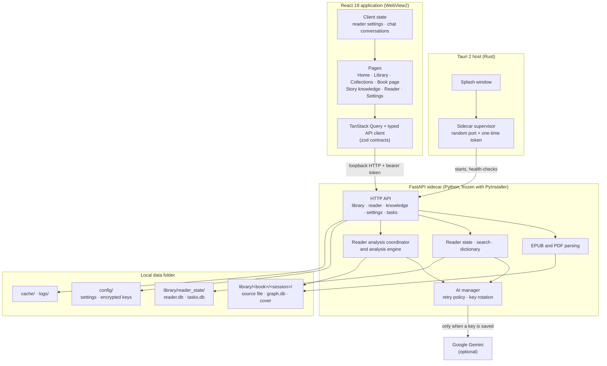
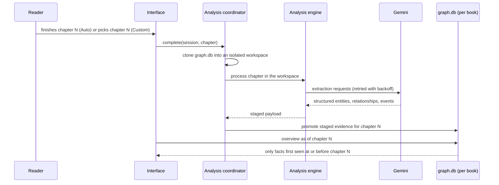

# BookBuddy architecture

This document describes how BookBuddy 0.3.0 is put together: the processes that
run, where data lives, and how a chapter turns into the story knowledge a reader
sees. Subsystem details live in the linked documents at the end.

## The three layers



| Layer | Location | Responsibility |
|---|---|---|
| Desktop host | `frontend/src-tauri/` | Owns the window and the backend process. Picks a free loopback port, generates a one-time bearer token, starts the sidecar, waits for an authenticated `/health`, then shows the main window. |
| Interface | `frontend/src/` | All screens. Talks to the backend only through `api/client.ts`. Never reads book files or databases directly. |
| Backend | `backend/` | Parsing, reading state, search, dictionary, analysis, AI calls, and every write to disk. |

The packaged app never uses a fixed port. The "Developer backend URL" in
Settings → Advanced only tests a separately started development backend and
never redirects application traffic.

## Interface

Routes are declared in `frontend/src/App.tsx`:

| Route | Page | Purpose |
|---|---|---|
| `/` | `HomePage` | Continue reading, streak and reading-time statistics. |
| `/library`, `/collections` | `LibraryPage`, `CollectionsPage` | Import, search, sort, shelves. |
| `/book/:book/:session` | `BookHubPage` | The book page: progress, analysis mode (Off, Auto, Custom), and tiles into story knowledge. |
| `/book/:book/:session/knowledge` | `KnowledgePage` | Characters, relationship map, timeline, and Ask. |
| `/reader/:book/:session` | `ReaderPage` | EPUB reader (epub.js) or PDF reader (`reader/pdf`). |
| `/settings` | `SettingsPage` | General, Reader, Library, Dictionary, AI, Performance, Advanced, About. |

State is split by lifetime:

- **Server state** is fetched with TanStack Query and validated against zod
  schemas in `types/contracts.ts`. A response that does not match its contract
  is treated as an error rather than rendered.
- **Reader preferences** live in a zustand store (`store/readerStore.ts`) and are
  persisted through the Tauri store plugin into `config/reader_settings.json`.
- **Chat conversations** live in `features/knowledge/chatStore.ts`. The store,
  not the chat panel, sends each question, so a conversation and a question that
  is still being answered survive leaving the page and appear the same in the
  reader's chat drawer. Conversations last for the app session.

`features/knowledge/AnalysisStateNotice.tsx` explains an empty story knowledge
page from the real state of the system (analysing, waiting on Gemini, stopped,
paused, off) instead of a generic message.

## Backend

`backend/app.py` builds the FastAPI application. `backend/bootstrap.py` wires the
long-lived services at startup and tears them down on shutdown.

| Area | Modules | Notes |
|---|---|---|
| Books | `epub_parser.py`, `pdf_parser.py`, `session_manager.py`, `session_state_store.py` | A book plus a reading session is the unit everything else is keyed by (`Book::Session`). Chapter titles come from the book's navigation, then heading tags, then a chapter-like first line. |
| Reader state | `dictionary_subsystem/reader_state.py` | Profiles, progress, bookmarks, annotations, statistics in `reader.db`. |
| Search | `reader_search.py` | Local full-text index per session, bounded by reading progress unless the reader asks for the whole book. |
| Dictionary | `dictionary_subsystem/` | Local WordNet and pronunciation, context-aware sense ranking. See [dictionary subsystem](dictionary_subsystem.md). |
| Analysis | `reader_analysis.py`, `analysis_engine.py`, resolvers and reconcilers | Turns chapter text into entities, relationships, and events. |
| Knowledge | `reader_knowledge.py`, `snapshot_manager.py` | Builds the reader-facing overview and chat prompt for a given chapter boundary. |
| AI | `ai/manager.py`, `ai/gemini_provider.py`, `ai_credentials.py`, `ai_settings_state.py` | One provider behind a provider-neutral manager. |
| Images | `image_pipeline/` | Local-first image understanding. See [image pipeline](image_pipeline.md). |
| Operations | `task_manager.py`, `database_maintenance.py`, `resource_manager.py` | Background-task records, backups, bounded caches. |

### From a chapter to story knowledge



Three rules hold this together:

1. **Isolation.** A chapter is analysed against a copy of the book's graph. The
   reader's knowledge database changes only when a finished chapter is promoted,
   so a failed or cancelled run leaves nothing half-written.
2. **The knowledge boundary.** Every reader-facing query takes an
   `as_of_chapter`. Overviews, lookups, search, and chat only see evidence first
   recorded at or before that chapter. Custom analysis moves this boundary for a
   book you have already read without touching reading progress or statistics.
3. **Placeholders stay internal.** While a narrator or character is unnamed the
   engine tracks them under a stand-in such as `[UNNAMED_POV]`. These are filtered
   out before anything reaches the reader.

Chapters of one book are analysed one at a time; different books can run in
parallel.

### AI requests

`AIManager.generate` is the single path to a provider. It applies pacing, rotates
keys, and retries quota and transient errors with exponential backoff.

- **Background analysis** uses the full retry budget, because nobody is waiting.
- **Interactive requests** (chat, explain, translate) pass `max_attempts=2` and a
  40-second deadline per attempt, so a busy provider produces an error the reader
  can retry instead of a spinner that runs for many minutes.
- The most recent provider failure is kept as `last_error` and returned by the AI
  settings endpoint. The interface uses it to say why analysis is not moving.

Text and vision keys are separate pools. Keys are encrypted for the current
Windows account and are never returned by the API, logged, or exported.

### Background work

`tasks.db` records background tasks so they can be listed, cancelled, and
retried. The work itself runs inside the backend process, so at startup any task
still marked queued, running, or cancelling belongs to a process that no longer
exists. Those are closed out as interrupted rather than left looking active.

## Data on disk

Everything lives beside the executable (portable) or in the install folder:

```text
library/
  <Book>/<Session>/source.epub|pdf     the imported book
  <Book>/<Session>/database/graph.db   that book's story knowledge
  reader_state/reader.db               progress, bookmarks, annotations, statistics
  reader_state/tasks.db                background-task records
  session_state.json                   library index
config/                                reader settings, AI settings, encrypted keys
cache/                                 covers, images, search index, analysis workspaces
logs/                                  application log, startup timings
runtime/                               the unpacked backend sidecar
```

Reader state and story knowledge are deliberately separate databases. A note or
highlight never becomes a story fact, and deleting AI keys or knowledge never
touches books or reading history.

## Build and release

`scripts/build_desktop.ps1` checks that every version declaration matches
`config/version.json`, freezes the backend with PyInstaller, builds the Tauri
application, and produces the NSIS installer and a portable zip.

Continuous integration (`.github/workflows/ci.yml`) runs on every push to `main`
and on pull requests:

| Job | Runner | Checks |
|---|---|---|
| Backend tests | Windows, Python 3.13 | version consistency, `unittest` suite including dictionary and PDF tests |
| Frontend checks | Ubuntu, Node 24, pnpm 11 | ESLint, Vitest, TypeScript build |

## Further reading

- [Desktop reader and packaging](desktop_reader.md)
- [Backend startup](backend_startup.md)
- [Dictionary subsystem](dictionary_subsystem.md)
- [Image pipeline](image_pipeline.md)
- [Pre-v1 architecture decisions](pre_v1_architecture_decisions.md)
- [Pre-retention contract](pre_retention_contract.md)
- [End-to-end audit](end_to_end_audit.md)
